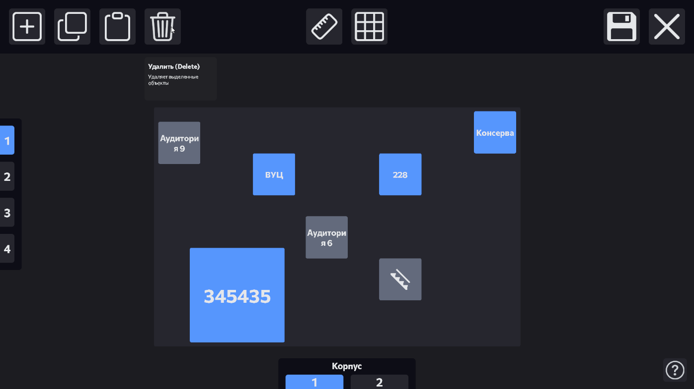
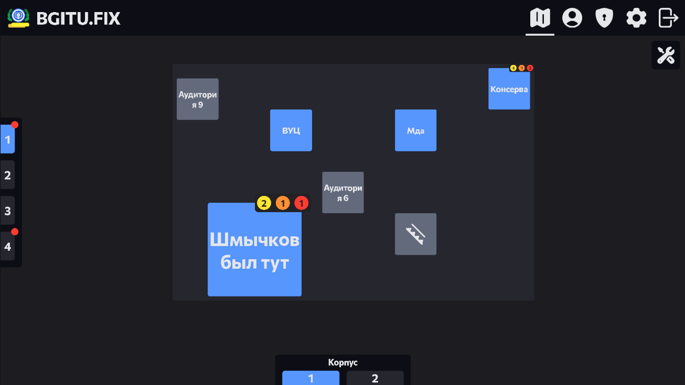
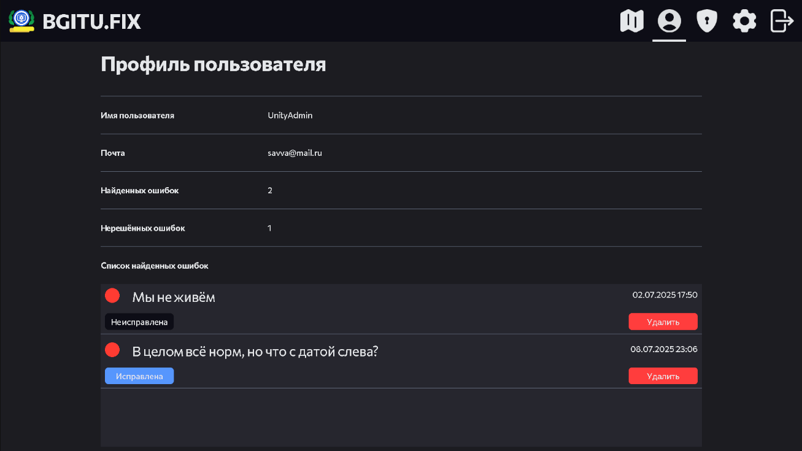

# Description

A platform for tracking computer malfunctions across an IT department of university
- Development was part of the winter and summer internships in 2025
- Includes a map of the university where users can mark malfunctioning devices
- Users with administrator privileges can view all reported issues, manage the user list, and edit the map
- Unfortunately, no working build is available because the test backend server has been shut down, while the production server is restricted to use within the university and cannot be distributed

# Key responsibilities

I was responsible for developing the PC and mobile versions of the application
- Connected the application to the backend via REST API and SSE, implementing authentication and request handling
- Developed a virtual map that loads data from the server
- Developed a user-friendly and functional map editor for university buildings and classrooms
- Created a dependency injection system using ObjectResolver
- Adapted the entire application for mobile devices

# Technical highlights

- An abstract map editing system used for both classroom maps and the general map (/_Project/Scripts/MapEditor)
- A system for interacting with the API, with built-in authorization token refresh functionality (/_Project/Scripts/API)
- An application login system (/_Project/Scripts/Login)
- An element selection system. Separating it from the general logic made it possible to configure more flexible system behavior and fix numerous existing bugs caused by differences in click behavior across devices (/_Project/Scripts/Select)

# What I would change

Given the project's scope and specific requirements, no technical changes are necessary.
Replacing ObjectResolver with a DI framework would be impractical given the project's small scale. 
The only notable limitation is that the map system lacks the flexibility to use its components independently. 
However, no use cases requiring this functionality ever arose, so implementing it would likely be overengineering.

# Screenshots

